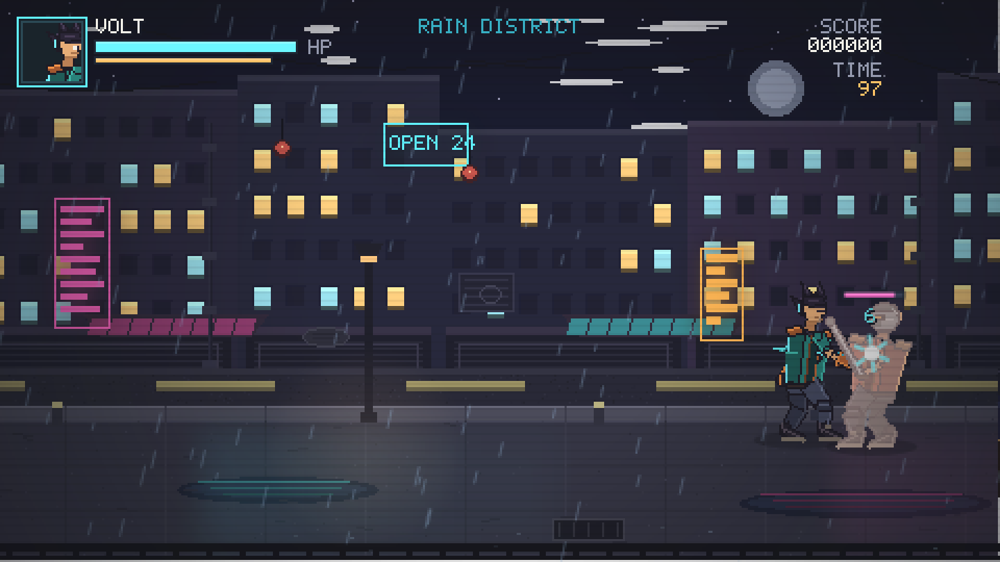

# NEON GAUNTLET

An **original** 16-bit-inspired 2D beat 'em up for the browser.
One playable character (VOLT, the Electric Gauntlet Fighter), four enemy
archetypes (rivet, runner, rivet elite, overlord), an **eight-stage campaign**
built from three to four waves per stage, a 12-second intro film and a full
sprite/stage build pipeline that runs from source code.

Streets of Rage 1 is used strictly as a **technical reference**: the project
reads its disassembly for object modes, inertia handling, hit detection and
frame timing, then rebuilds the behaviour at a different resolution with
original art. No Sega ROM, sprite, palette, tile, sound or level asset is
included or required.



---

## 1. What is in the slice

| Feature | Status |
|---|---|
| Playable character with 12 animations (idle, walk, jab/cross/roundhouse, jump, jump attack, hurt, fall, get up, special, victory, defeated) | delivered |
| 2.5D movement: horizontal + depth lane + jump height | delivered |
| 3-hit combo, jump attack, radial electric special with a real health cost | delivered |
| Hit detection with per-frame boxes, one hit per target per attack, i-frames, hit-stop, knockback, knockdown and get-up | delivered |
| Four enemy archetypes sharing one sprite sheet with per-type stats and draw scale (`rivet`, `runner`, `rivet_elite`, `overlord` boss) and a spawn/approach/attack/hurt/fall/get-up/defeat state machine | delivered |
| Campaign: **8 stages** (`config/stages.json`, generated by `tools/stage_pipeline/make_stages.py`), 3-4 waves each, per-stage timer, health/damage scaling and colour theme, stage-to-stage hand-off with "NEXT" banner, results screen with campaign totals | delivered |
| Stage 1: 1800 px rainy neon street, 5 parallax layers, rain/lightning, camera follow + wave lock, 3 waves, finish trigger | delivered |
| Destructible props (2 crates, trash bag, barrel) with health pickups and score pickups | delivered |
| Intro cinematic, 12 s, 4 shots, with in-engine playback and an MP4 export | delivered |
| Autopilot playthrough + proof frames + 50 s gameplay recording | delivered |
| 25 automated behaviour/asset/campaign tests, 84-frame art QA gate (0 errors, 3 intentional hold-frame warnings) | delivered |
| Audio: procedural WebAudio SFX + stage bed (no external audio files) | delivered |
| Gamepad and touch controls | delivered |

---

## 2. Download and play (one file, offline)

[`dist/neon-gauntlet.html`](dist/neon-gauntlet.html) is the whole game in a single
HTML file (~0.48 MB): 12 inlined scripts, the config bundle (including the
eight-stage campaign), the bitmap font and all 102 PNGs as base64 data URIs.
It has no external reference of any kind.

1. On GitHub open the file and click **Download** (or use the Raw link).
2. Double-click the downloaded file - it opens from `file://` and runs offline.
3. Press **Enter**.

There is no server, no install and no companion folder. The exported MP4 is not
embedded; the intro is drawn by the game's own cinematic code, which is the same
code that produced the MP4.

Rebuild it after changing anything:

```bash
python3 tools/build_standalone.py     # -> dist/neon-gauntlet.html
node tools/tests/standalone.js        # boots the file, decodes every image, clears all 8 stages
```

---

## 3. Quick start (development server)

Requirements: **Node 18+** (tested on 22.22.3). Nothing else is needed to play.

```bash
git clone <this repo> && cd fd
node tools/serve.js            # http://localhost:8080/game/
```

Open `http://localhost:8080/game/` and press **Enter**.
The page needs a local HTTP server; opening `index.html` from the filesystem
will fail because the browser blocks `file://` image loads into canvas.

The intro movie also auto-plays when you press Enter on the title screen.
`http://localhost:8080/game/watch.html` plays the exported MP4 version.

Controls: arrows/WASD move, **J** attack (tap again to chain), **K** jump,
**L** special (costs 8 HP), **Esc** pause, **M** mute. Full table:
[`docs/controls.md`](docs/controls.md).

---

## 4. Architecture

```
index.html
  ├─ game/src/generated/data.js   config bundle (built, do not edit)
  ├─ game/assets/fonts/font5x7.js bitmap font (built)
  └─ game/src/
       core.js       math, RNG, timers, sfx queue
       assets.js     image loading + config accessors
       font.js       5x7 text renderer with colour atlases
       input.js      keyboard / gamepad / touch -> abstract actions
       audio.js      procedural WebAudio SFX and music
       actors.js     player + enemy state machines, hit resolution
       stage.js      waves, props, pickups, camera, arena, campaign hand-off
       render.js     parallax, rain, depth sorting, HUD, effects
       cinematic.js  the 12 s intro (same code used for the MP4)
       main.js       fixed 60 Hz loop, scenes, autopilot
```

* Fixed simulation step of 1/60 s with an accumulator; rendering is decoupled.
* Gameplay state lives on plain objects (`game.player`, `game.enemies`,
  `game.props`), which is why the headless test harness can drive the real
  modules without a browser.
* No balance number is hard-coded in engine code: every speed, damage, timing
  and hit box comes from `config/*.json`.
* `config/stage.json` is the hand-tuned stage 1; `config/stages.json` holds the
  campaign. `FD.setStage(i)` swaps the active stage into `FD.cfg.stage`, so
  every module keeps reading one stable accessor.

More: [`docs/architecture.md`](docs/architecture.md).

---

## 5. Dependencies

**Runtime (the game):** none. Plain ES5/ES2017 scripts and Canvas2D, no bundler,
no framework, no network calls.

**Development / tooling:**

| Tool | Version | Used for |
|---|---|---|
| Node.js | 22.22.3 (>=18) | tests, capture, movie, static server |
| `@napi-rs/canvas` | 0.1.100 | headless Canvas2D for tests, screenshots and video |
| Python | 3.11 | asset pipeline + QA |
| Pillow | 13.0.0 | raster art, atlases, validation |
| numpy | 2.4.6 | pixel/array helpers |
| imageio-ffmpeg | 0.6.0 | bundled ffmpeg used by `movie.js` |

`npm install` installs `@napi-rs/canvas` only. The Python packages are only
needed if you rebuild assets or re-render video. The exact inventory, including
what the sandbox could and could not download, is in
[`reports/00-dependency-inventory.json`](reports/00-dependency-inventory.json).

---

## 6. Folder structure

```
config/                 single source of truth for all numbers
  animation.json        canvases + per-frame timing + per-frame hit boxes
  movement.json         walk/depth/jump/gravity/camera
  collision.json        body sizes and depth tolerances
  combat.json           damage, hit-stop, knockback, cooldowns, enemy stats
  stage.json            stage 1: world, lane, waves, props, pickups
  stages.json           the eight-stage campaign (generated, do not hand-edit)
  presentation.json     render tuning (rain, bloom, HUD)
game/
  index.html            the game
  watch.html            standalone MP4 player for the cinematic
  src/                  engine modules (see above)
  assets/
    characters/volt/{frames,spritesheets,previews,manifest.json}
    characters/rivet/{frames,spritesheets,previews,manifest.json}
    stage/{layers,props,ui}
    fonts/
tools/
  asset_pipeline/       rig, font, stage, bundler, design sheet, build_all
  stage_pipeline/       make_stages.py — the campaign generator
  validation/           sprite QA gate
  tests/                run.js (23 tests), playtest.js (E2E), standalone.js
  capture/              harness.js, screenshots.js, movie.js
  build_standalone.py   inlines everything into dist/neon-gauntlet.html
  serve.js              zero-dependency static server
dist/
  neon-gauntlet.html    the downloadable single-file build
reports/                environment, engine choice, RE evidence, state machines,
                        physics, data formats, asset QA
docs/                   architecture, controls, calibration
cinematic/              storyboard.md, spec.json, rendered-video.mp4
artifacts/              screenshots, playtest frames, videos, calibration, test logs
```

---

## 7. Building assets

The art is **generated**, not hand-painted file by file. `rig.py` is a small
parametric skeletal renderer (two-bone IK, shaded torso, helmet, scarf,
gauntlets with glow arcs); `build_stage.py` draws the parallax street from code.

```bash
python3 -m pip install pillow numpy
python3 tools/asset_pipeline/build_all.py --docs
```

That runs, in order:

1. `font5x7.py` -> `game/assets/fonts/font5x7.{json,js}`
2. `build_characters.py` -> 84 frames, 19 spritesheets, previews, manifests
3. `build_stage.py` -> 5 layers, props, UI, stage manifest
4. `bundle_data.py` -> `game/src/generated/data.js`
5. with `--docs`: `design_sheet.py` -> `artifacts/design-sheet.png`, then
   `validate_assets.py` -> `reports/asset-validation.json`

Adding a frame or a whole animation is described in section 9.

---

## 8. Running the tests

```bash
npm test                    # 25 behaviour + asset + campaign tests, headless
npm run validate            # sprite/sheet/manifest QA gate
npm run playtest            # scripted end-to-end run, writes artifacts/playtest*
npm run build:standalone    # rebuild dist/neon-gauntlet.html
npm run test:standalone     # boot the single file, decode its images, clear all 8 stages
node tools/capture/screenshots.js   # 14 PNGs into artifacts/screenshots/
node tools/capture/movie.js all     # cinematic + gameplay MP4 (needs ffmpeg)
```

`npm test` prints one line per test and writes `artifacts/test-results.json`;
`npm run validate` writes `reports/asset-validation.json`. Exit code is non-zero
on failure.

The tests run the **production** modules through a ~60-line DOM shim
(`tools/capture/harness.js`) on `@napi-rs/canvas`; they do not re-implement
gameplay. They cover frame resolution, canvas and anchor sizes, frame durations,
walk/attack/jump measurements, combo chaining, one-hit-per-target, i-frames,
knockdown recovery, special damage **and its 8 HP cost**, prop drops, pickups,
wave locking, the full stage clear, game over -> retry, pause, the campaign
config (8 stages, monotonic triggers, lanes, exactly one boss per stage 2-8,
generator freshness via `make_stages.py --check`) and an eight-stage
playthrough to the results screen.

---

## 9. Tuning physics and adding animation

All tunables are JSON. Edit and either reload the page (the game reads the
bundle) or re-run `build_all.py` to refresh `data.js` and the docs.

| Want to change | File | Key |
|---|---|---|
| Walk / depth speed | `config/movement.json` | `player.walkSpeed`, `player.depthSpeed` |
| Jump height / hang time | `config/movement.json` | `player.jumpVelocity`, `gravity` |
| Camera dead zone | `config/movement.json` | `camera.*` |
| Depth tolerance | `config/collision.json` | `rules.depthTolerance` |
| Damage / hit-stop / knockback | `config/combat.json` | `player.attacks.*`, `enemies.*` |
| Special cost / cooldown / radius | `config/combat.json` | `player.special.*` |
| Stage wave composition and triggers | `config/stage.json` | `waves` |
| Campaign stages, timers, scaling | `config/stages.json` | `stages[]` (generate with `make_stages.py`) |
| Frame timing / hit boxes | `config/animation.json` | `characters.<id>.animations.<anim>.frames` |

A frame entry looks like:

```json
{ "dur": 3, "hit": { "x": 10, "y": -56, "w": 30, "h": 16 } }
```

`dur` is in 60 Hz ticks; `hit` is anchor-relative (feet at 0,0, forward +x),
`"radial": true` marks the special. The renderer, the spritesheet builder and
the validator read the same array, so art and gameplay cannot drift apart.

**To add an animation**

1. Add a `Pose` sequence in `tools/asset_pipeline/rig.py` (or reuse existing
   pose builders) and register it in `POSES`/`ANIMS`.
2. Add the matching entry to `config/animation.json` with `loop` and one
   `{ "dur": n }` per frame (plus `hit` boxes if it attacks).
3. Reference it from `actors.js` (`setAnim(actor, 'name')`) and, if it is a new
   player action, add the state and its exit condition.
4. `python3 tools/asset_pipeline/build_all.py --docs` and `npm test`.

Frames are 128x96 RGBA, anchor (64, 88), authored facing right in a 112 px box
padded 8 px on each side; the engine mirrors them for left-facing actors.

---

## 10. The cinematic (what actually works)

`cinematic/storyboard.md` -> `cinematic/spec.json` -> `cinematic/rendered-video.mp4`
(12.0 s, 1440x810, 30 fps, H.264, silent).

**Integration is verified in two independent ways, and neither assumes that an
MP4 in the folder is playable by the engine:**

1. **In-engine playback** - `game/src/cinematic.js` draws the same four shots
   from the same stage layers, rig and font. Pressing Enter on the title screen
   runs it inside the game canvas and it can be skipped with Enter. This is the
   path the player actually sees.
2. **MP4 playback** - `game/watch.html` embeds `cinematic/rendered-video.mp4`
   with a `<video>` element; this is a separate page, not part of the game loop.

The MP4 is produced by `tools/capture/movie.js`, which steps the same
`cinematic.js` at 30 fps and pipes the frames into ffmpeg. There is no
AI-video step and no hand editing, so the two versions cannot diverge.

---

## 11. Evidence and reverse engineering

Streets of Rage 1 was analysed **without a ROM**, from the text listings of
`gsaurus/sor-disassemblies` (Streets of Rage (JUE) REV 00) with
`Dandaman955/Streets-of-Rage-1-Disassembly-Redux` (Bare Knuckle J) used only as
a cross-check. Every claim is tagged with confidence and a location:

* [`reports/02-evidence-ledger.json`](reports/02-evidence-ledger.json) - 9 records
  (`SOR1-E001..E009`) with address/line, evidence, confidence, uncertainty and
  what it changed downstream.
* [`reports/02-reverse-engineering.md`](reports/02-reverse-engineering.md) - the
  narrative: object mode tables, `Update_Inertia`, `Chk_Hit`, frame timers.
* [`reports/02-physics-parameters.json`](reports/02-physics-parameters.json) -
  extracted constants next to the values this game actually uses.
* [`reports/03-physics-and-feel.md`](reports/03-physics-and-feel.md) - why the
  numbers differ (320x224 vs 480x270, lane size, hit-stop).
* [`reports/02-state-machines.md`](reports/02-state-machines.md),
  [`reports/02-data-format-notes.md`](reports/02-data-format-notes.md).

Engine selection: OpenBOR is the policy default, but its runtime could not be
downloaded or executed in this environment (see
[`reports/00-environment-audit.md`](reports/00-environment-audit.md)). The
slice therefore ships as a self-contained Canvas2D build whose engine is
written here, and the decision plus its consequences are recorded in
[`reports/01-architecture-decision.md`](reports/01-architecture-decision.md)
(ADR-001..004) and [`reports/01-engine-comparison.md`](reports/01-engine-comparison.md).

---

## 12. Asset provenance and licensing

* **Code** in this repository: written for this project.
* **Art**: 100 % generated by `tools/asset_pipeline/*.py` from shapes and
  colours defined in this repository. No SoR1 sprite, palette, tile, logo,
  font or sound is included. The bitmap font is a 5x7 glyph set drawn here.
* **Audio**: synthesised at runtime with WebAudio oscillators/noise; no audio
  files are shipped.
* **Reference material**: no ROM is included or required. Disassembly listings
  are used as documentation only; they contain no playable assets.
* **Third-party code**: `@napi-rs/canvas` (MIT) as a dev dependency;
  `imageio-ffmpeg` (BSD-2) only if you re-render video. The shipped game has no
  third-party runtime dependency.

If you plan to redistribute, keep the reference-game names out of your own
branding (this project uses its own title, characters and stage names).

---

## 13. Known limitations

* **Depth lane is shallow** (46 px) relative to SoR1's arena; enemies and the
  player can overlap heavily. Depth tolerance was widened to ±15/±17 px to
  compensate, but this is not SoR1 geometry.
* **No audio files**: the soundtrack is a short procedural loop, not a
  composed track, and there is no voice work.
* **One playable character, one sprite sheet for all four enemy archetypes.**
  Variety comes from stats, draw scale, tint and AI parameters; the overlord is
  a 1.25x scaled elite, not a bespoke boss rig.
* **Stage themes are tint-only.** All eight stages reuse the same five parallax
  layers with a per-stage colour wash; the layout (props, waves, width) is what
  changes. Bespoke backdrops would need new `build_stage.py` scenes.
* **The MP4 cannot be played inside the game canvas**; the in-game intro is a
  separate engine-side rendering of the same shots. This is deliberate and
  documented in section 10.
* **OpenBOR was not built or run** in this environment, so the default engine
  could not be validated; no OpenBOR package is claimed to work.
* **ROM-level fidelity is not claimed**: the reference extraction came from a
  text listing of the JUE REV 00 build, and several values (i-frame duration,
  get-up timing, exact attack boxes) were not recoverable. They are marked as
  design choices, not extracted facts.
* **The sandbox cannot run headless Chromium**, so browser verification was
  done through the Canvas2D shim plus static server smoke tests, not a real
  browser session.

---

## 14. Reproducing everything from scratch

```bash
npm install
python3 -m pip install pillow numpy imageio-ffmpeg
python3 tools/stage_pipeline/make_stages.py   # config/stages.json
python3 tools/asset_pipeline/build_all.py --docs
npm test && npm run validate && npm run playtest
node tools/capture/screenshots.js
node tools/capture/movie.js all
python3 tools/build_standalone.py && node tools/tests/standalone.js
node tools/serve.js
```

Outputs land in `reports/asset-validation.json`, `artifacts/test-results.json`,
`artifacts/calibration.json`, `artifacts/playtest.json`,
`artifacts/screenshots/` and `artifacts/video/`.
